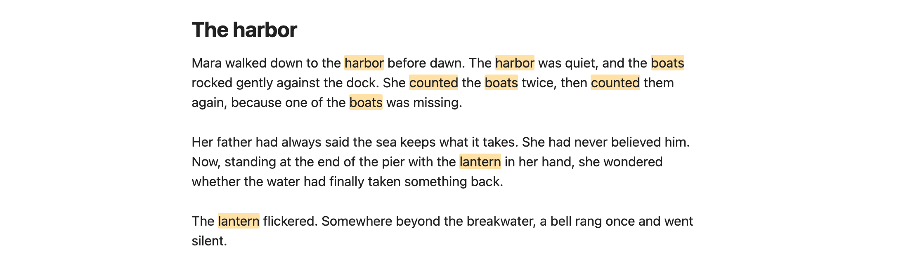
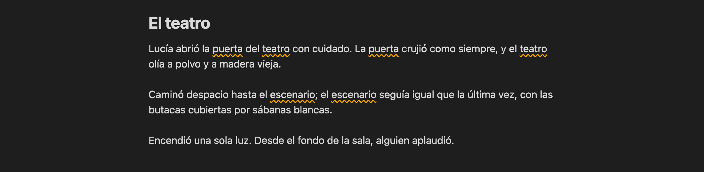
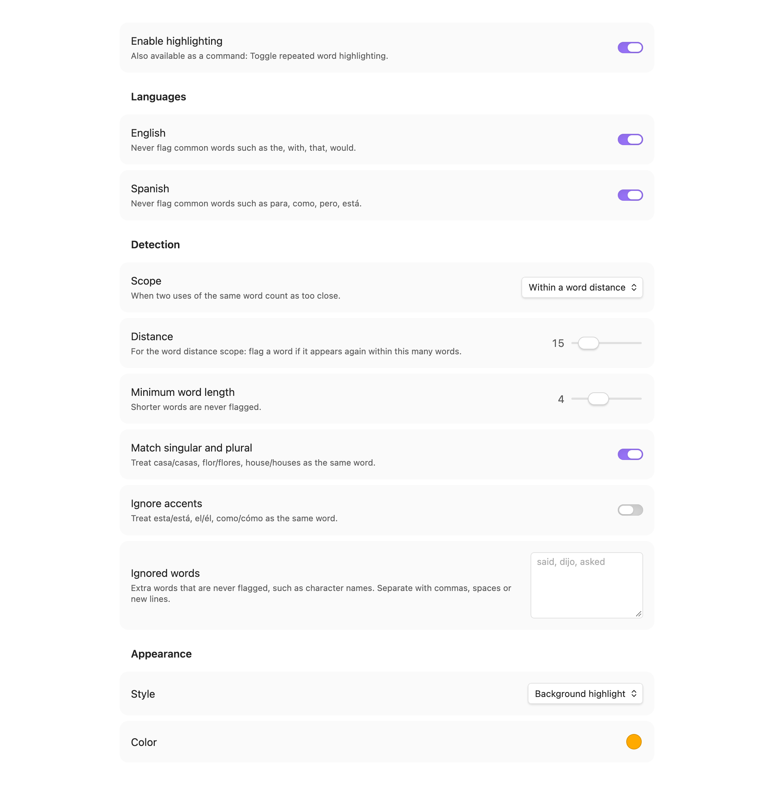

# Repeated Words

Obsidian plugin that highlights words repeated too close together while you write, in English and Spanish.

Hover a highlighted word to see how far apart the repeats are.





## Settings

- **Languages**: English and/or Spanish common words (the, with, para, como…) are never flagged.
- **Scope**: within N words, same sentence, or same paragraph.
- **Distance**: max words between repeats (word distance scope only).
- **Minimum word length**: shorter words are ignored.
- **Match singular and plural**: casa/casas, flor/flores, house/houses.
- **Ignore accents**: esta/está, como/cómo count as the same word.
- **Ignored words**: your own list, such as character names.
- **Style / Color**: background highlight or wavy underline.



Command: **Toggle repeated word highlighting** (assign a hotkey in Settings → Hotkeys).

Skips frontmatter, code blocks, inline code, math, links, URLs, tags and `%%comments%%`.
Works in Live Preview and Source mode (not Reading view).

## Develop

```bash
npm install
npm run dev     # watch build
npm run build   # production build
npm test        # detection unit tests
npm run lint    # Obsidian's official lint rules (same as the plugin review)
npm run screenshots  # regenerate docs/images (macOS, needs Obsidian and Chrome)
```

## Install manually

Copy `main.js`, `manifest.json` and `styles.css` to `<vault>/.obsidian/plugins/repeated-words/`,
then enable **Repeated Words** in Settings → Community plugins.

## Support

If this plugin helps you write, you can buy me a coffee:

<a href="https://buymeacoffee.com/coffeedrivendev"></a>

## License

[MIT](LICENSE)
